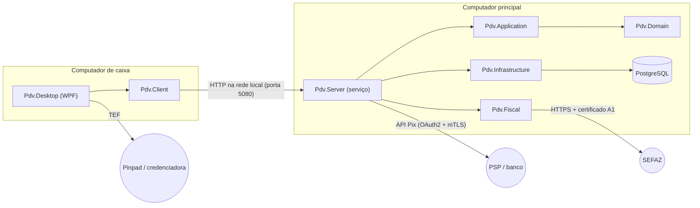
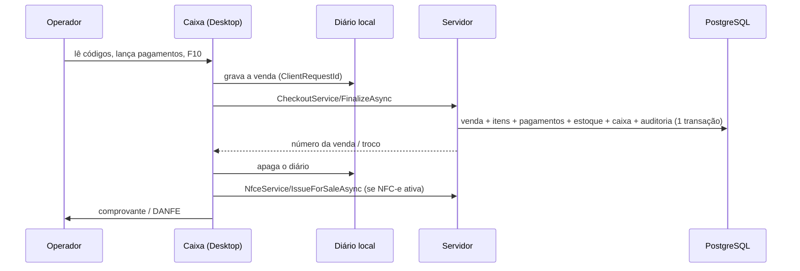

# Visão geral e arquitetura

## Objetivo

Frente de caixa e retaguarda para o pequeno e médio varejo brasileiro: venda rápida por código de barras,
pagamento dividido, caixa com abertura/sangria/suprimento/fechamento, estoque por movimentações, compras com XML da
NF-e, devoluções com vale-troca, relatórios e emissão de NFC-e — com vários caixas na mesma loja.

## Tecnologias

| Camada | Tecnologia |
|---|---|
| Runtime / linguagem | .NET 10 LTS, C# 14 |
| Caixa (interface) | WPF + CommunityToolkit.Mvvm 8.4 |
| Servidor da loja | ASP.NET Core 10 (Kestrel, minimal APIs) como serviço do Windows |
| Banco | PostgreSQL 17 (Npgsql) + Entity Framework Core 10 com migrações |
| Fiscal | DFe.NET / Zeus (LGPL 2.1) para XML, assinatura e webservices da SEFAZ; QRCoder (MIT) para o QR da NFC-e |
| Logs técnicos | Serilog em arquivo diário |
| Testes | xUnit v3 no Microsoft.Testing.Platform |

## Projetos

```
src/
  Pdv.Domain           Entidades e regras de negócio puras (sem dependências externas)
  Pdv.Application      Casos de uso (serviços), contratos e o contrato remoto (RemoteApi)
  Pdv.Infrastructure   EF Core/PostgreSQL, migrações, hash de senha, backup (pg_dump), configuração da NFC-e
  Pdv.Fiscal           NFC-e: montagem do XML, assinatura, comunicação com a SEFAZ, SEFAZ simulada
  Pdv.Server           Servidor da loja: API para os caixas, backup agendado, fila da NFC-e
  Pdv.Client           Lado do caixa: cliente HTTP, ServerRunner, diário da venda, conexão
  Pdv.Desktop          Programa do caixa (WPF): frente de caixa e retaguarda
tests/
  Pdv.Domain.Tests          Regras puras (totais, arredondamento, caixa, estoque, devolução)
  Pdv.Infrastructure.Tests  Serviços sobre PostgreSQL real (idempotência, concorrência, relatórios, NFC-e)
  Pdv.Fiscal.Tests          Chave de acesso, XML e assinatura
  Pdv.Server.Tests          Servidor completo em memória: caixas, quedas, 3 caixas simultâneos, backup
installer/                  Inno Setup + script de publicação
tools/                      Utilitários (ex.: geração do ícone)
```



Regras de dependência: `Domain` não depende de nada; `Application` depende só de `Domain` (e das abstrações do
EF Core para consultas); `Infrastructure` e `Fiscal` implementam portas da `Application`. O caixa (`Desktop → Client →
Application`) **não referencia** `Infrastructure` nem `Fiscal`: não tem como abrir o banco nem ler o certificado.

## Fluxo de uma venda



- O `ClientRequestId` nasce com o carrinho e só muda depois de uma venda concluída ou descartada: reenviar após erro
  de rede nunca duplica (índice único no banco).
- A NFC-e é emitida **depois** de gravada a venda e nunca a desfaz (ver [Fiscal](fiscal.md)).

## Chamadas remotas (RPC)

Os serviços da `Application` são classes comuns, testadas diretamente contra o banco. O caixa os chama pelo
`ServerRunner`, escrevendo a chamada como se fosse local:

```csharp
var result = await runner.RunAsync<CashService, Result<CashSessionSummary>>(c => c.OpenAsync(terminalId, userId, valor, default));
```

O `ServerRunner` lê a árvore de expressão, avalia os argumentos e envia `POST /api/rpc/CashService/OpenAsync` com
`[terminalId, userId, valor, null]` em JSON. O servidor (`RpcDispatcher`) acha o método, desserializa cada argumento
pelo tipo do parâmetro, cria um escopo de DI (um `DbContext` por chamada) e devolve o resultado. Detalhes, erros e
segurança em [Servidor da loja e caixas](servidor-e-caixas.md).

Regras para métodos expostos (verificadas por teste): sem sobrecarga, sem tuplas, sem entidades do domínio nos
parâmetros/retornos (só records de dados), coleções como `IReadOnlyList`/`IReadOnlyCollection`/`IReadOnlyDictionary`.

## Decisões técnicas

| Decisão | Motivo |
|---|---|
| PostgreSQL | Sem limite de tamanho nem custo de licença (substituiu o SQL Server LocalDB/Express) |
| Servidor central em vez de acesso direto ao banco | Caixas sem senha do banco e sem certificado; um só lugar para migrações, backup e NFC-e; versão controlada |
| Movimentações em vez de saldos (estoque e caixa) | Histórico completo e auditável; estorno por lançamento compensatório |
| Um `SaveChanges` por venda | Atomicidade: ou tudo é gravado, ou nada |
| Concorrência otimista com `xmin` | Venda × fechamento simultâneos, numeração fiscal entre caixas, uso simultâneo de vale-troca |
| Datas em UTC (`DateTimeOffset`) | Conversor global grava sempre em UTC; relatórios agrupam pelo fuso local |
| UUID v7 como chave | Ordenável por tempo, menos fragmentação de índice |
| `decimal` e `Money.Round` único | 2 casas, meio para cima, por linha de item: total exibido = total gravado |
| Biblioteca fiscal própria (DFe.NET) | Sem custo por nota; regras fiscais versionadas no código |
| Pix pela API padronizada do Banco Central | Um único adaptador serve à maioria dos bancos/PSPs; credenciais só no servidor |
| TEF no caixa, em três fases | O pinpad fica no caixa; confirmar só após gravar a venda evita cobrança sem venda |
