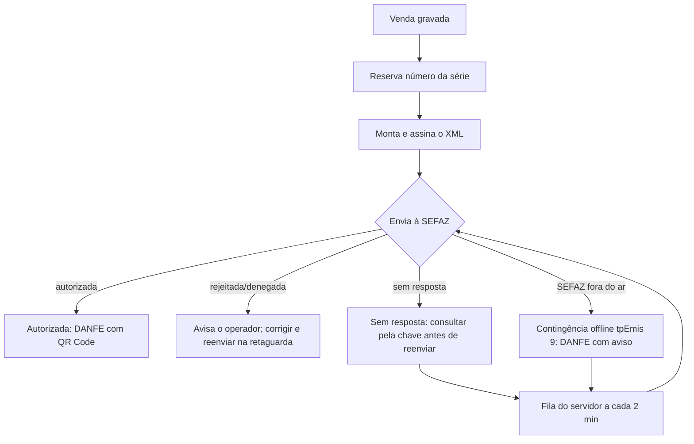

# Fiscal e NFC-e

> As alíquotas, CFOPs, CSOSN/CST e NCMs de exemplo são ilustrativos. A configuração tributária de cada loja deve ser
> validada pelo contador. A homologação na SEFAZ real depende da UF, do certificado A1 e do CSC (ver pendências no
> [roadmap](ROADMAP.md)).

## Cadastro fiscal

- **Empresa** (Retaguarda › Empresa): razão social, fantasia, CNPJ (numérico ou alfanumérico), IE, IM, regime
  (CRT 1 Simples, 2 Simples excesso, 3 Normal, 4 MEI), endereço com código IBGE, telefone e perfil tributário padrão.
- **Perfis tributários** (Retaguarda › Tributação): CFOP, CSOSN (Simples/MEI) ou CST do ICMS (regime normal) com
  alíquota, PIS/COFINS (CST e alíquotas). O sistema impede perfil incompatível com o regime. Dois modelos iniciais com
  alíquotas zeradas: "Revenda — Simples Nacional (CSOSN 102)" e "Revenda — Regime normal (CST 00)".
- **Produto:** NCM, CEST, origem e perfil próprio (ou o padrão da empresa). A retaguarda avisa produtos sem NCM.
- Na venda, cada item grava o retrato fiscal (NCM, CFOP, CSOSN/CST, alíquotas) e a venda grava o CPF/CNPJ do consumidor.

## Configuração da emissão

Retaguarda › NFC-e (permissão `company.manage`), guardada **no servidor** e válida para todos os caixas:
ativar/desativar, ambiente (homologação/produção, com confirmação para produção), série, certificado A1 (.pfx enviado
pelo caixa e gravado na pasta do servidor; conferido com a senha e a validade antes de salvar), senha do certificado e
CSC (ID + código). Senha e CSC ficam cifrados com DPAPI em `nfce.json`; nunca voltam para o caixa.

Todos os caixas usam a mesma série; o número é reservado no banco com controle de concorrência (dois caixas nunca pegam
o mesmo número).

## Fluxo de emissão

- A venda é gravada primeiro; a NFC-e **nunca desfaz a venda**.
- Reenvio seguro: nota enviada sem resposta é **consultada pela chave** antes de qualquer reenvio; duplicidade (cStat
  204) também vira consulta, nunca um segundo número.
- Contingência offline: emitida com tpEmis 9 e transmitida automaticamente quando a SEFAZ volta.
- Cancelamento: pela venda (F7, que cancela antes a NFC-e) ou pela retaguarda, com justificativa de 15+ caracteres,
  dentro do prazo configurado (padrão 30 minutos).
- DANFE NFC-e com QR Code (QRCoder), impresso em bobina.

## Formas de pagamento na NFC-e

| Pagamento no PDV | `tPag` | Grupo `card` |
|---|---|---|
| Dinheiro | 01 | — |
| Crédito / débito pelo **TEF** | 03 / 04 | `tpIntegra = 1`, `CNPJ` da credenciadora, `tBand`, `cAut` |
| Crédito / débito em maquininha separada | 03 / 04 | `tpIntegra = 2` |
| Pix com **QR dinâmico** confirmado pelo PSP | 17 | `tpIntegra = 1`, `CNPJ` do PSP (configurado na retaguarda) |
| Pix sem integração | 20 | — |
| Vale-troca | 05 (crédito loja) | — |

A biblioteca fiscal só nomeia as bandeiras Visa, Mastercard, Amex, Sorocred e Diners; as demais (Elo, Hipercard…) saem
como `99`. O grupo `card` do Pix dinâmico deve ser validado na homologação da UF.

## SEFAZ simulada

Com `Pdv:Fiscal:Simulator = true` (ligado no ambiente Development do servidor), o XML é montado e assinado de verdade,
mas nada é enviado: as respostas são simuladas. Só funciona em homologação. Serve para desenvolvimento, demonstração e
treinamento — **nunca** envie notas de teste à SEFAZ real com certificados de teste.

## Pendências fiscais

Inutilização de numeração; validação pelos XSD oficiais; tributos aproximados (Lei 12.741/IBPT); demais CSOSN/CST;
grupos IBS/CBS da reforma; NF-e de entrada para devoluções. Ver [roadmap](ROADMAP.md).
